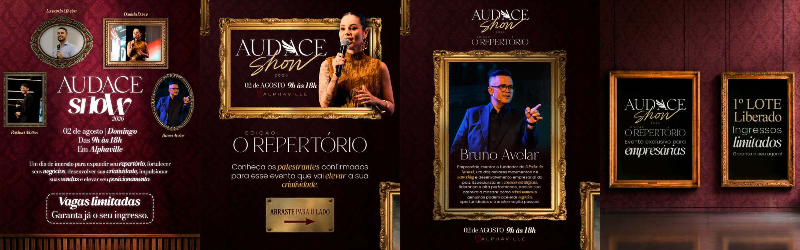
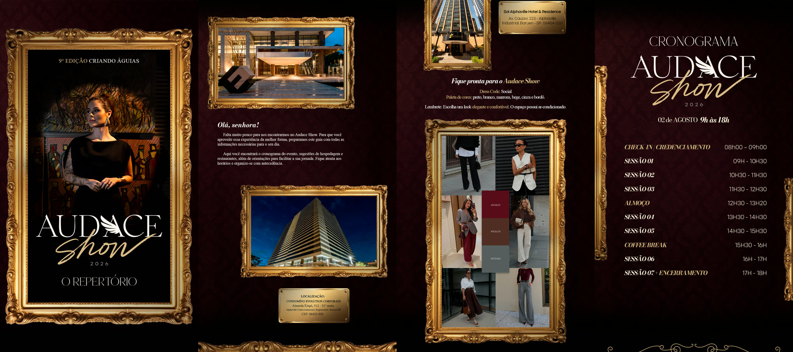
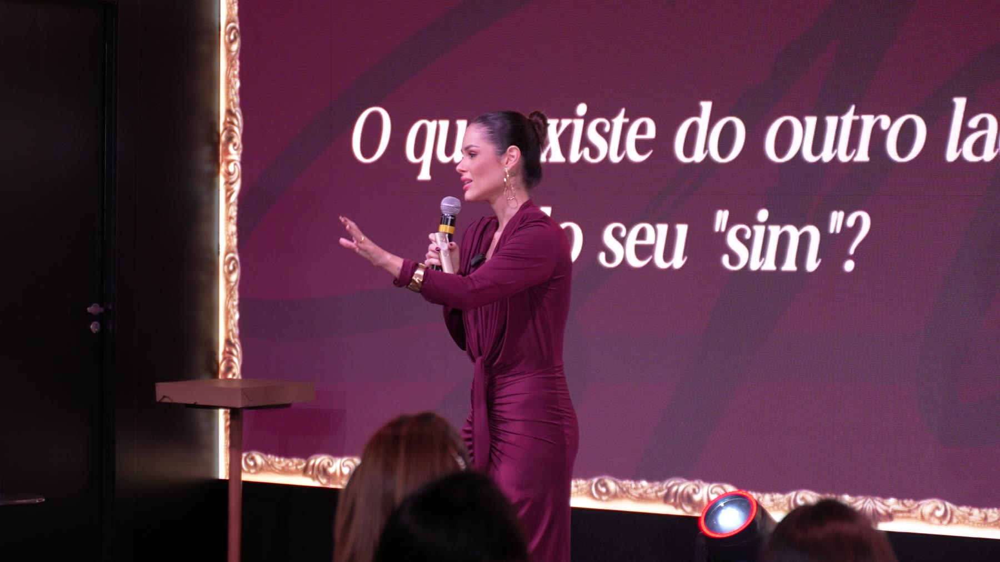
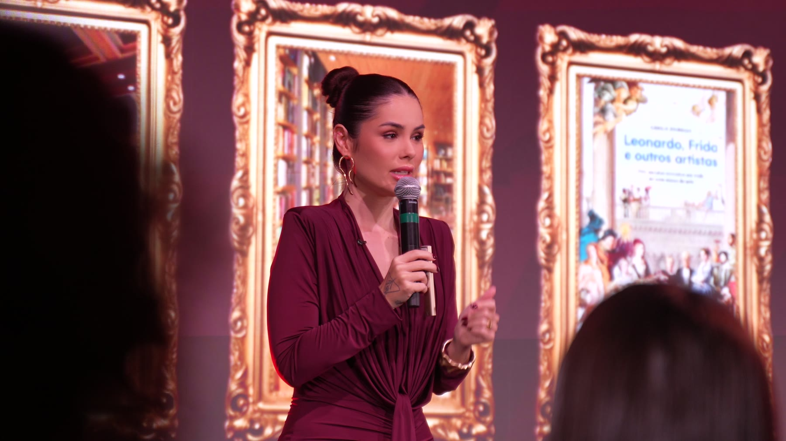

## Sobre o Audace Show

O **Audace Club** é a comunidade de mentoria para mulheres empresárias liderada por **Daniela Daroz**. Durante oito edições, o grande encontro do clube se chamou *Criando Águias*. Na nona edição, o evento ganhou nome, formato e ambição novos: nasceu o **Audace Show 2026 – Edição O Repertório**, um dia inteiro de imersão em Alphaville para expandir repertório, fortalecer negócios, desenvolver criatividade, impulsionar vendas e elevar posicionamento.

A **Agência Zava** cuidou de tudo o que a participante viu, ouviu e levou para casa: o conceito, a campanha de lançamento, os materiais impressos, os vídeos exibidos no telão e a cobertura do dia.

## O desafio

Rebatizar um evento que já tinha história é delicado. O público do Criando Águias precisava entender que aquilo não era o fim de nada, e sim uma evolução, ao mesmo tempo em que a nova marca tinha que se sustentar sozinha para atrair empresárias que ainda não conheciam o clube. E, por ser um evento sobre *repertório*, a própria experiência tinha que ser rica em detalhes, do convite ao encerramento.

## A ideia: uma galeria de arte

Partimos da palavra **repertório** e a levamos ao pé da letra: um repertório é uma coleção de obras. O Audace Show virou uma galeria, cada palestrante um quadro em destaque e cada participante uma obra em construção. Molduras douradas, bordô profundo, tipografia clássica e quadros famosos deram o tom de todo o projeto.

### Campanha de lançamento

A virada de nome foi contada em três vídeos de antecipação, narrados pela Dani, que tratavam o Criando Águias como uma obra viva: *Toda obra evolui*, *Todo artista amadurece* e *Toda galeria recebe novas coleções*. Depois vieram a chamada oficial, a arte do evento, o carrossel e os posts individuais de cada palestrante, a abertura de lotes, os lembretes, o filtro #EuVou para os stories e uma landing page para o grupo VIP de pré-venda.

### Guia da participante

Para quem comprou o ingresso, desenhamos um guia digital no mesmo universo de galeria, com local, palestrantes, sugestões de hotéis e restaurantes, dress code com paleta de cores e o cronograma completo do dia.

### Impressos e ambientação

No espaço do evento, a galeria saiu da tela: backdrop para fotos, crachá VIP Pass, placa com a trajetória das edições do Criando Águias, sinalização de palco, manopla de microfone, moleskine personalizado e até uma lata de energético própria, o **Audace Power**.

### Telão

Criamos as vinhetas de entrada de cada palestrante (Daniela Daroz, Bruno Avelar, Greice Joviane, Leonardo Oliveira e Raphael Mattos), o vídeo geral do evento em três formatos para as telas do espaço, uma série de depoimentos de empresárias do clube e um recap da comunidade Audace.

### Cobertura

No dia, registramos palestras, plateia e bastidores. Esse material virou os reels pós-evento e uma série de depoimentos de participantes, que mantêm o Audace Show vivo nas redes até a próxima edição.

## O que as participantes levaram

> “Eu gostei muito do jeito que a Dani vem conduzindo o evento, como ela vem atiçando todos os nossos sentidos, desde quando a gente chega no evento até nas palestras.”
>
> Brenda Rodrigues, coordenadora de marketing

> “Eu decidi entrar pro clube depois desse evento, porque eu vi que eu tenho muito potencial, mas eu estava no ambiente errado. E esse ambiente é o certo.”
>
> Participante do Audace Show, franqueada do Instituto Visão Solidário

