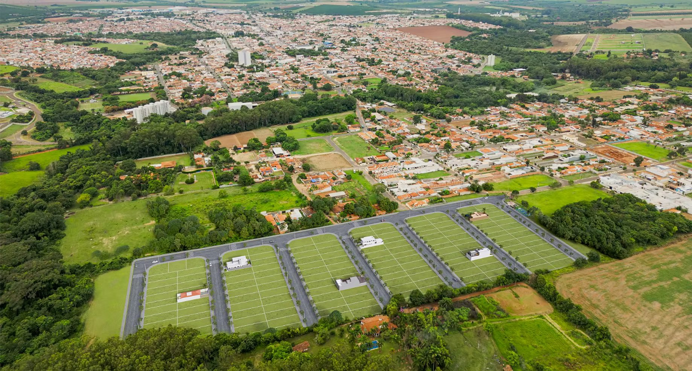

## Sobre o Jardim Emília

O **Jardim Emília** é um novo empreendimento imobiliário em Conchal – SP, focado na comercialização de lotes residenciais. O desafio era gerar alto volume de interesse, atrair compradores qualificados e transformar o lançamento em um evento de vendas de alto impacto.

A **Agência Zava** foi responsável por toda a estratégia de comunicação e performance, atuando desde a criação de materiais offline até campanhas digitais e produção audiovisual.

## O desafio

Lançar um empreendimento do zero exige mais do que visibilidade: é preciso gerar desejo, urgência e confiança no público. O objetivo era posicionar o Jardim Emília como uma oportunidade atrativa de investimento e moradia, garantindo forte presença local e alto volume de conversão no dia do lançamento.

## A estratégia

Criamos uma abordagem integrada, combinando mídia offline e online para maximizar alcance e conversão:

- **Fortalecimento da presença local** com materiais impressos estratégicos
- **Conteúdo audiovisual persuasivo** para reforçar o posicionamento do empreendimento
- **Campanhas de tráfego pago** altamente segmentadas, focadas em geração de leads qualificados e aquecimento do público para o lançamento

### Impressos

Desenvolvemos peças como outdoors e flyers, com comunicação direta, visual atrativo e foco em chamada para ação, aumentando o reconhecimento do empreendimento na cidade e região.

### Audiovisual

Produzimos conteúdos dinâmicos voltados para redes sociais e anúncios, destacando os diferenciais do loteamento e criando conexão emocional com o público.

### Tráfego pago

Estruturamos campanhas estratégicas para captação de leads e remarketing, otimizando o funil de vendas e preparando o público para o grande dia do lançamento.
